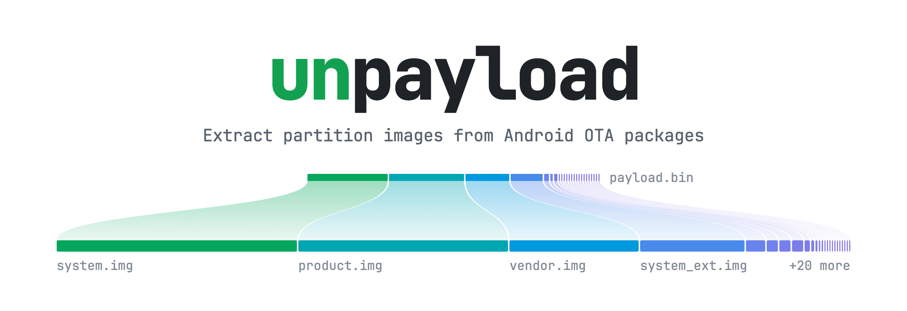
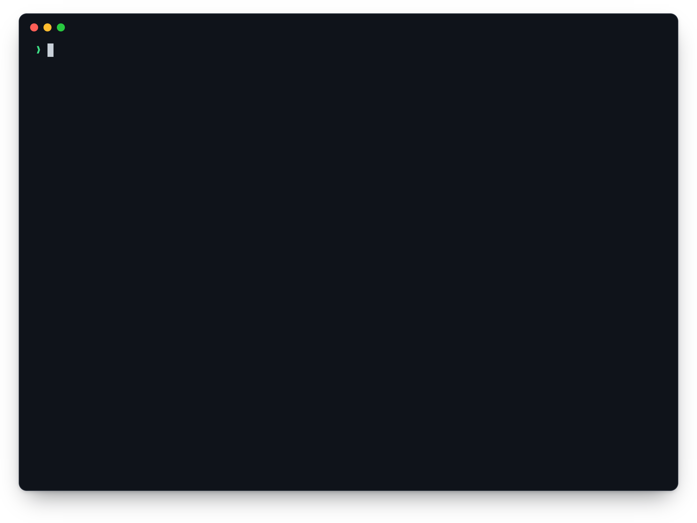
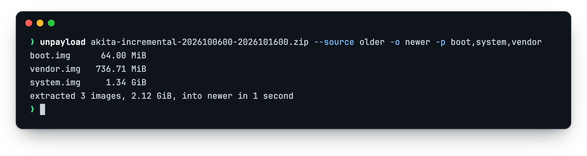
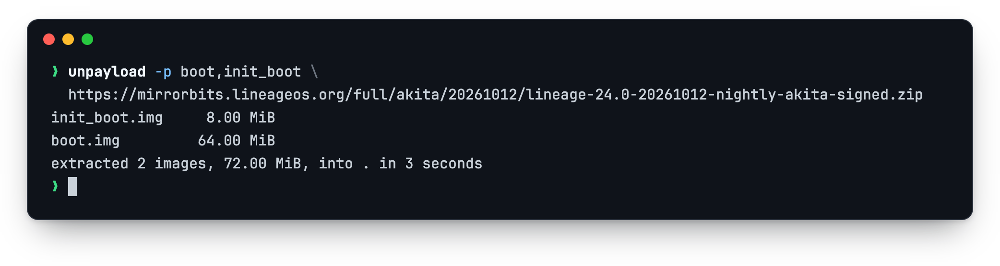

<p align="center">
  <picture>
    <source media="(prefers-color-scheme: dark)" srcset="assets/banner-dark.png">
    
  </picture>
</p>



- Full and incremental OTAs, including PUFFDIFF, ZUCCHINI and LZ4DIFF operations
- `payload.bin` or the OTA zip itself, on disk or over HTTP
- SHA-256 verification of every image
- dm-verity hash tree and FEC rebuilding

## Install

```sh
cargo install --git https://github.com/kirklin/unpayload
```

## Usage

```sh
unpayload ota.zip                           # every partition, into the current directory
unpayload ota.zip -p boot,init_boot -o out  # boot and init_boot, into out/
unpayload ota.zip --list                    # list partitions
unpayload ota.zip --json                    # progress and images as JSON lines
```

### Incremental OTAs

Point `--source` at the images of the build the update starts from.



### Remote OTAs

Pass a URL: range requests fetch only the parts the chosen partitions need.



## License

[MIT](LICENSE)
